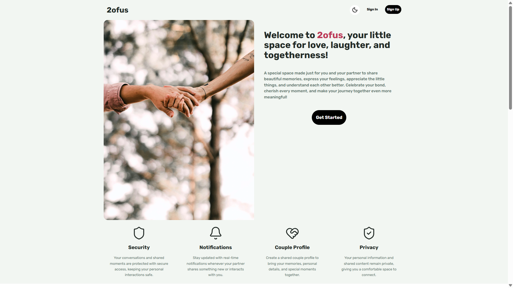
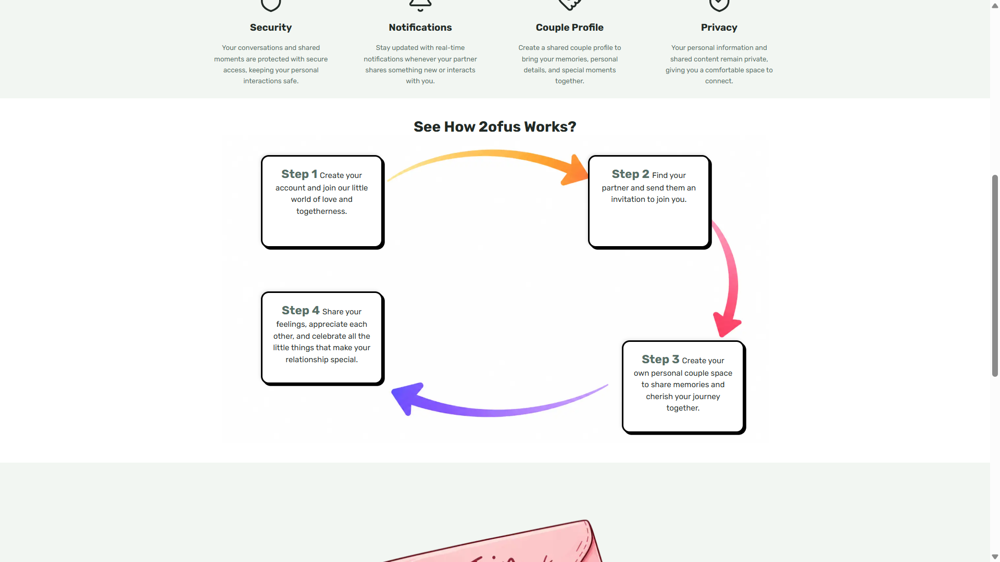
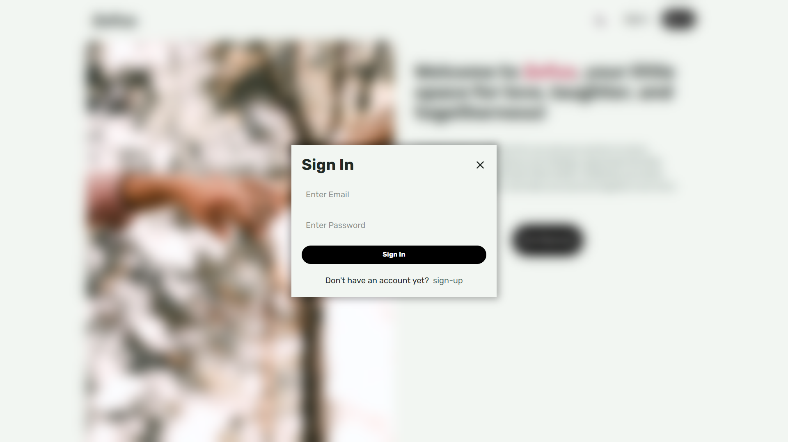
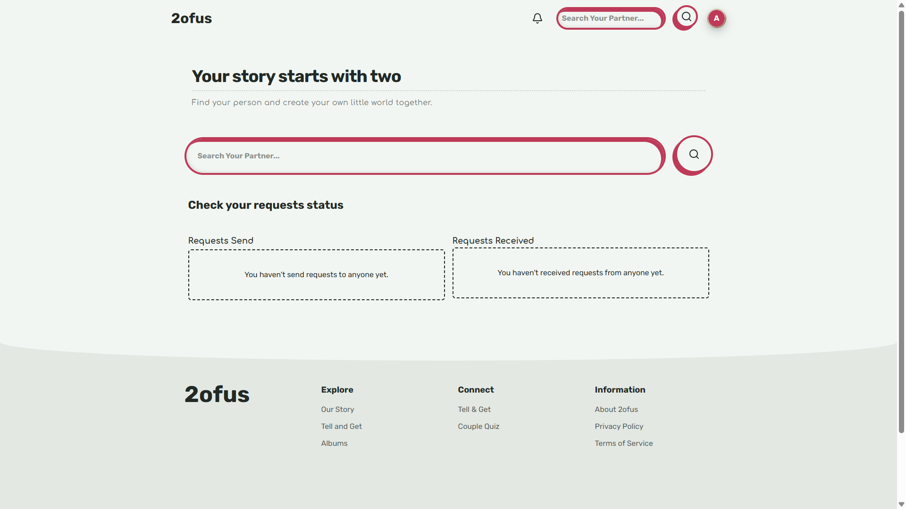
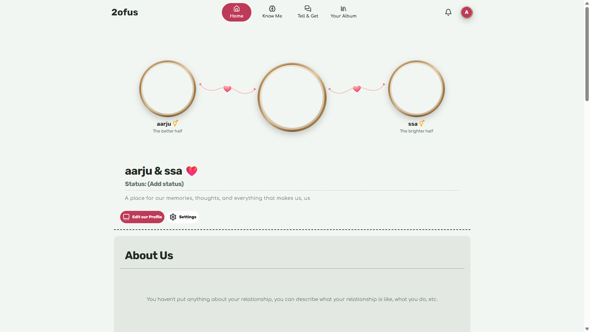
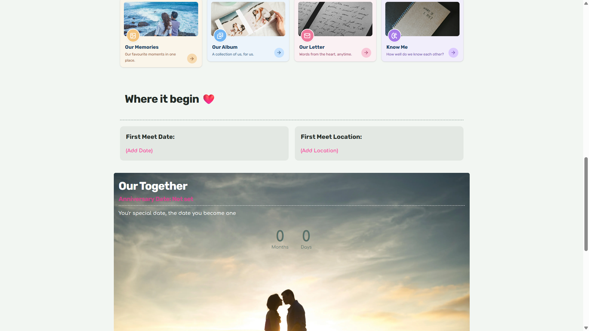
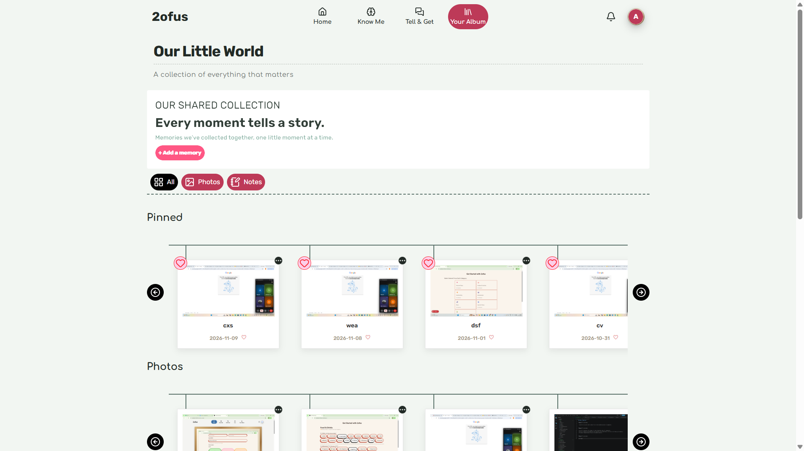
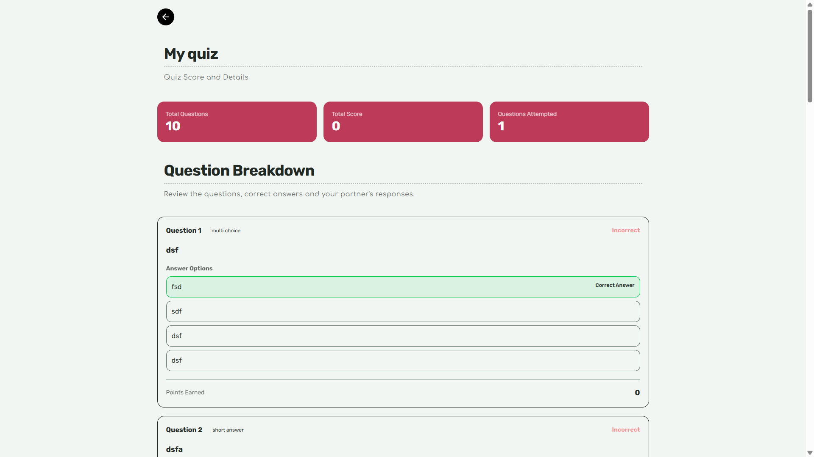
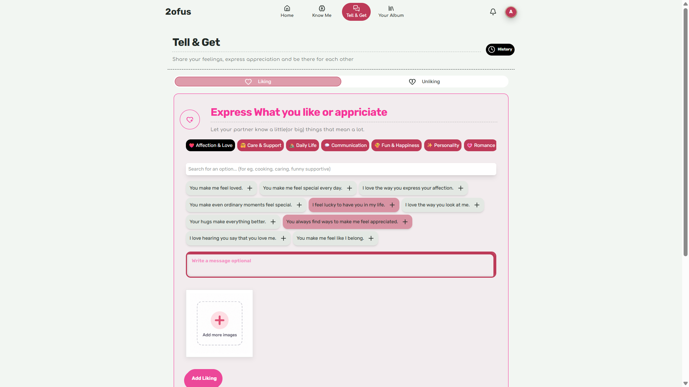
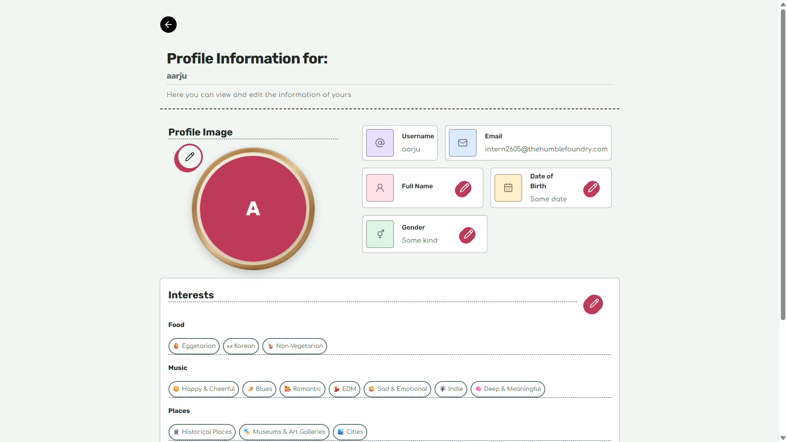

# 2OFUS - Couple Supportive Platform

## Overview

2ofus is a platform designed to address real-world challenges that couples encounter while navigating relationships, regardless of whether they are short-term or long-term.

Maintaining a relationship involves more than affection; it requires understanding boundaries, resolving conflicts, overcoming communication barriers, and continuously understanding one another as individuals.

The platform aims to simplify these complexities by providing tools that help couples address relationship obstacles, establish and maintain healthy boundaries, preserve meaningful memories, and rediscover the evolving characteristics, preferences, and personalities of their partners.

Ultimately, 2ofus aspires to create a private digital space where couples can strengthen their connection, navigate interpersonal difficulties, and cultivate a deeper understanding of each other.




# How I Build it?

## The Beginnning - What inspired it?

2ofus was developed with the intention of creating a cohesive, private, and interactive digital environment for couples.
The platform was developed to address real-life problems that couples face, become a part of their everyday routines to maintain a strong bond, and help mitigate conflicts within their relationships.

## The Idea - What was the Original Vision?

During the initial planning of the platform, the idea was to develop a relationship-management platform where each couple would have their own personal space, maintaining their privacy and addressing their concerns without unnecessary exposure.

The platform was also intended to encompass certain gamified features, such as quizzes, fun activities, and games, making the experience more engaging for couples.

## Planning & Conceptualisation - How it turned to a blueprint?

One of the initial things worked on was understanding how users would connect with one another on the platform. For instance, how would an individual user account create or become part of a couple profile? Since a single couple profile was supposed to be shared between two individuals, I needed to figure out how both user accounts would be connected to the same profile.

Another important aspect was deciding which functionalities should be available to users based on their current status within the application. For example, a user who has created an account but isn't yet part of a couple should be able to search for other users on the platform, view their profiles, send connection requests, and receive, accept, or reject requests from others.

On the other hand, a user who is already part of a couple profile should have access to the shared storage, platform features, and other functionalities associated with their couple profile. This required establishing distinctions between individual user access and couple-level access.

Other important planning considerations included individual user access and couple-level access.

This also involved planning the database schema and architecture, including the tables required, such as users, couples, memories, and requests, to store important user information like usernames, profile images, and other relevant details.

Another important part of the planning was identifying the core functionalities, such as supabase realtime for real-time notifications and the complete request-sending and receiving cycle between users.

## Development & Challenges - How it was build?

### Development

The development began with creating the core pages for the interfaces, such as the home page, profile creation page, landing page, etc. Then, the planned database tables were implemented, along with the routes for different server-side requests to ensure secure handling of user data.

Next, the couple profile interfaces were developed, creating a beautiful home page for couples to display their important details, such as:

- Bio Image

- Description

- Couple Name

- Anniversary Date

- Relationship Status, etc.

The key features of the platform were then implemented, such as a quiz feature where couples can create personalised quizzes for their partners to check how well they know each other, an album section where couples can store their images and notes to keep their memories together, and a Tell & Get feature to let each other know their feelings.

The final part included some improvements throughout the platform, fixing minor and major bugs, and finalising the project.

### Challenges

#### 1. Data Security & Encryption
- **Challenge:** Ensuring that sensitive user data remained private and inaccessible to unauthorised users.
- **Approach:** Implementing encryption and decryption mechanisms for sensitive information.
- **Implementation:**
  - Album data and notes written by couples were encrypted before storage.
  - Quiz questions and answers were stored in cipher format.
  - Tell & Get history was also encrypted before storage.
- **Solution:** Sensitive information was decrypted only when required by authorised operations.

#### 2. User Authorization & Data Access
- **Challenge:** Managing user permissions and ensuring that users could only access their respective resources.
- **Approach:** Implementing user-level authorization checks throughout the application.
- **Implementation:**
  - Validating the current user's identity during navigation and data operations.
  - Restricting quiz creators from attempting their own quizzes.
  - Ensuring users could only access the appropriate couple-related resources.

#### 3. Quiz Creation & Management
- **Challenge:** Keeping quiz questions, submitted answers, and correct answers private between partners.
- **Approach:** Implementing encryption mechanisms throughout the quiz lifecycle.
- **Implementation:**
  - Encrypting questions and answers before database storage.
  - Decrypting information only during the required operations.
  - Maintaining answer confidentiality during quiz attempts and evaluation.

#### 4. UI Design & Presentation
- **Challenge:** Creating visually engaging interfaces that complemented the personal and playful nature of the platform.
- **Approach:** Using different visual design concepts for different sections.
- **Implementation:**
  - Album: Scrapbook-inspired design for storing photographs and notes.
  - Tell & Get History: Timeline-like layout for revisiting previously shared feelings and interactions.


# Features

- **Authentication & Authorization:** Secure login, signup, and access control throughout the application.
- **Profile Management:** Create, update, and manage personal profiles.
- **User Search:** Search for other users on the platform.
- **Real-Time Notifications:** Get notified about important activities and updates.
- **Couple Requests:** Send, accept, and reject requests to connect with another user.
- **Couple Profile:** Create and manage a shared private space with your partner.
- **Tell & Get:** Share your thoughts, feelings, likes, and dislikes with each other, either directly or indirectly.
- **Album:** Store memorable photographs with titles and dates, along with personal notes for each other.
- **Quiz:** Create personalised quizzes for your partner to test how well you know each other. Quiz scores are also stored so you can check your performance later.
- **Data Encryption:** Encrypt sensitive information before storing it and decrypt it when required.
- **Storage Management:** Handle image uploads and storage for profile pictures, albums, and other application features.


# Tech Stack

- **Next.js:** React framework used for building the application.
- **TypeScript:** For type safety and better code organisation.
- **Tailwind CSS:** For styling and building responsive interfaces.
- **Supabase:** Used for authentication, database integration, storage, and real-time features.
- **PostgreSQL:** Relational database used to store and manage application data.


# How to Run Locally

1. Clone the repository:
   ```bash
   git clone <repository-url>
   ```

2. Navigate to the project directory:
   ```bash
   cd 2ofus
   ```

3. Install the dependencies:
   ```bash
   npm install
   ```

4. Create a `.env` file in the root directory and add all the required environment variables, including your Supabase credentials.

5. Start the development server:
   ```bash
   npm run dev
   ```

6. Open [http://localhost:3000](http://localhost:3000) in your browser to access the application.

**Note:** Make sure all required environment variables are configured before running the application. Never expose your secret keys or commit your `.env` file to GitHub.


# Problems in Project

- Notification UI: Some profile images displayed in notifications are not properly rounded, resulting in inconsistent image styling.

- Tablet Navigation UI: The couple navigation interface does not adapt optimally to tablet screen sizes, as its layout currently falls between the mobile and desktop layouts.

- Quiz Submission: In certain cases, quizzes may remain unsubmitted due to potential submission issues, occasionally making them inaccessible to both users.

- Quiz Delete Button: In couple profile, the user delete button is still visible to the one user who is not the conductor of the quiz.

- Date Hydration Warnings: Some components may encounter Date.now()-related hydration warnings during development due to differences between server-side rendering and client-side rendering. These warnings do not occur in the production build and currently have no significant impact on application functionality.

# AI Usage

- **UI & Responsiveness:** Used AI for fixing minor UI bugs, mobile responsiveness issues, component alignment, and layout improvements.
- **Debugging:** Took assistance in identifying and fixing issues related to authentication, routing, pagination, image handling, and other component behaviours.
- **Supabase & Database:** Used AI for documentation and guidance on Supabase storage buckets, database policies, and managing user permissions.
- **Encryption:** Took help in understanding encryption and decryption mechanisms, including fixing an authentication tag issue.
- **Feature Planning:** Used AI to brainstorm and refine the couple request management workflow, including sending, accepting, rejecting, and cancelling requests.
- **Component Development:** Took assistance in understanding and improving reusable components such as Dropdown, PlayfulButton, and other UI components.
- **Quiz Functionality:** Used AI for guidance on quiz submission routes, individual answer score calculation, and overall quiz score calculation.
- **Notifications:** Took assistance in understanding the notification workflow and how real-time updates should work when couple requests are sent or accepted. The final implementation was done independently.
- **Design Suggestions:** Used AI for brainstorming UI layouts, colour combinations, and improvements for the Home, Album, and Tell & Get pages. The final designs and implementations were different from the suggestions.
- **Storage & Image Handling:** Used AI to identify issues with image paths, profile image deletion, and photograph component sizing.
- **Other Assistance:** Used AI for generating the interests catalogue and emojis, understanding new libraries, and referring to technical documentation when required.


## Credits

- **Images:** Some images used in the application were sourced from [Unsplash](https://unsplash.com/).
- **Designed Images:** Some of the designed images and visual elements were created using Canvas.
- **Technologies:** Built using Next.js, TypeScript, Tailwind CSS, Supabase, and PostgreSQL.


# Screenshots

















